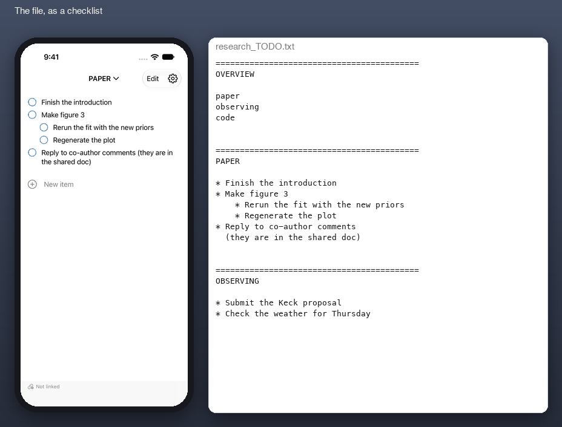

# rdo

An iPhone front end for a plain-text TODO file that lives in Dropbox and is
otherwise edited in vim.



Left: the app. Right: the text file it is editing, as seen on the laptop.

## What it does

- Shows a `research_TODO.txt`-style file as a checklist, one section per
  `=====` header, with nesting from indentation.
- Tap to mark done (`*` to `-`), swipe left to mark won't-do (`~`), tap the
  text to edit it, and a Notes-style bar above the keyboard for indent,
  outdent, new item, and won't-do.
- Edits only the lines you touch. Everything else round-trips byte for byte,
  so the file stays exactly as vim left it. Edited text is re-wrapped at 80
  columns with a hanging indent.
- Syncs through the Dropbox API with a revision check on every write, and a
  three-way merge when the laptop and the phone both changed the file.
- Completed items stay in place. Moving them to a done file is left to the
  laptop.

## File format

```
==========================================
SECTION TITLE

* to do
    * nested to do
- done
~ won't do
* a long item wraps at 80 columns with a hanging indent, like
  this
----------
free text, dividers, and blank lines pass through untouched
```

## Build

1. Create a Dropbox app at dropbox.com/developers/apps (scoped access, full
   Dropbox), enable `files.content.read` and `files.content.write`, and add
   the redirect URI `db-<APP KEY>://oauth`.
2. Copy `Config.xcconfig.example` to `Config.xcconfig` and fill in the app
   key and your Apple team id.
3. Open `PhoneList.xcodeproj` in Xcode 15 or later and run on a phone.
   The project is generated from `project.yml` with xcodegen.
4. In the app, open Settings and link Dropbox. The path defaults to
   `/research_TODO.txt`.

## Tests

- `./test.sh` runs the core tests (parser, edits, rewrap, merge). Works with
  only the Command Line Tools installed.
- `xcodebuild test -project PhoneList.xcodeproj -scheme PhoneList -destination 'platform=iOS Simulator,name=iPhone 17'`
  runs the UI tests, which drive the real app in the simulator and check the
  exact file text it produces.

## Layout

| Path | Contents |
|---|---|
| `Sources/PhoneListCore` | Document model, parser, edit operations, rewrap, three-way merge, Dropbox client. Foundation only. |
| `Sources/PhoneListUI` | SwiftUI views and the sync store. |
| `Tests`, `UITests` | Core tests and simulator UI tests. |
| `App` | App entry point, Info.plist, icon. |
| `scripts` | `make_icon.py`, `record_demo.sh`, `make_demo_gif.py`. |
| `docs` | Design notes, the original prompt, session log, demo gif. |

The Xcode project, package, and bundle id keep the working name PhoneList.
Named for the vim mapping that opens the TODO and done files on the laptop.

MIT license.
